# flutter-food-cart-hive-provider

A **Food Ordering App** with shopping cart, built in Flutter using **MVC**, **Provider**, **Hive**, **Firebase Auth**, **Cloud Firestore**, and **Firebase Cloud Messaging (FCM)**.

## Assignment context

| Session | Focus |
|---|---|
| **Week 10 · Session 20** | Food cart with Provider and Hive |
| **Week 11 · Session 21** | Dart extensions (form fields, validators, search helpers) |
| **Week 11 · Session 22** | Firebase Auth, COD checkout, UI polish |
| **Week 12 · Session 23** | Firestore users CRUD, profile, **roles** (`user` / `admin`) |
| **Week 12 · Session 24** | Cloud Notifications (FCM) — model, service, listen, save token |

Repository: [devDoniaAlhosin/food-ordering-provider-hive](https://github.com/devDoniaAlhosin/food-ordering-provider-hive.git)

## Overview

Browse a sample food menu, search items, add them to a cart (with editions and special instructions), then check out with **cash on delivery**. Cart data persists locally with Hive. Users **login / register** with Firebase Auth; each account is stored in Firestore `users/{uid}`.

**Access control (Session 23):**
- Every signed-in user manages **only their own account** via **My profile**.
- **Manage users** (list / create / edit / delete all users) is available **only to admins**.

**Notifications (Session 24):**
- FCM permission + device token saved on `users/{uid}.fcmToken`
- Receive test pushes from Firebase Console
- Local notification when a COD order is placed

## What has been done

### Base S20
- Food menu, cart CRUD, totals, Hive persistence, MVC + Provider

### Session 21 — Extensions
- Dart field extensions, validators, search helpers
- Notes / quantity field helpers used across forms

### Session 22 — Auth & checkout
- Firebase Auth login / register
- COD checkout, UI theme polish

### Session 23 — Firestore users + roles
| Area | What was added |
|---|---|
| **UserFirestoreService** | Create / read / update / delete on `users` collection |
| **AppUser model** | `uid`, `email`, `fullName`, `phone`, `address`, **`role`**, timestamps |
| **Roles** | `user` (default) · `admin` (can manage all users) |
| **UserProvider** | Current profile, `isAdmin`, admin-gated users CRUD |
| **Register sync** | Creates Firestore doc after Auth register (`role: user`) |
| **Profile screen** | Each user edits **own** name / phone / address · can **delete own account** |
| **Users list** | **Admin only** — add Auth+Firestore user, edit role/fields, delete |
| **Menu avatar** | My profile for everyone · Manage users **only if admin** · Sign out |
| **Checkout** | Prefills delivery fields from Firestore profile |

### Session 24 — Cloud Notifications (FCM)
| Area | What was added |
|---|---|
| **AppNotification model** | Parses FCM `RemoteMessage` → title / body / data |
| **NotificationService** | Permission, FCM token, foreground local alerts, background handler |
| **Token sync** | Saves `fcmToken` on Firestore `users/{uid}` after login |
| **Android** | `POST_NOTIFICATIONS` + default channel `food_orders` |
| **Order placed** | Local notification after successful COD checkout |

## Features

- Food menu with search, notes, cart, COD checkout
- Firebase Auth login / register
- Firestore user profile (self-service edit + delete account)
- Admin role with full users management
- Cloud push notifications (FCM) with foreground display
- Mobile bottom tabs: Menu · Cart · Profile
- Hive cart persistence
- Dart extension methods for form fields

## Technologies used

| Technology | Role |
|---|---|
| Flutter / Dart | UI framework |
| Provider | State management |
| Hive | Local cart storage |
| Firebase Auth | Login / register |
| Cloud Firestore | Users CRUD + roles |
| Firebase Cloud Messaging | Push notifications |
| flutter_local_notifications | Foreground notification UI |
| Material 3 | Theming |

## Project folder structure

```
lib/
├── main.dart
├── firebase_options.dart
├── theme/app_theme.dart
├── Model/
│   ├── food.dart
│   ├── order_item.dart
│   ├── checkout_order.dart
│   ├── app_user.dart
│   └── app_notification.dart
├── Controller/order_controller.dart
├── Provider/
│   ├── order_provider.dart
│   ├── auth_provider.dart
│   └── user_provider.dart
├── Services/
│   ├── hive_cart_service.dart
│   ├── auth_service.dart
│   ├── user_firestore_service.dart
│   └── notification_service.dart
├── extensions/
├── data/sample_foods.dart
└── View/
    ├── auth_gate.dart
    ├── auth/login_screen.dart
    ├── auth/register_screen.dart
    ├── food_menu_screen.dart
    ├── cart_screen.dart
    ├── checkout_screen.dart
    ├── main_shell.dart
    ├── profile_screen.dart
    ├── users_list_screen.dart
    └── widgets/food_card.dart
```

## Auth + Firestore + roles flow

```text
Register / Login (Firebase Auth)
        ↓
Create / load Firestore users/{uid}  (role defaults to "user")
        ↓
Food Menu
  ├─ My profile     → any user edits own account
  └─ Manage users   → admin only (CRUD + set role)
        ↓
Cart → Checkout (COD, prefilled from profile)
```

### UserFirestoreService (CRUD)
- Collection: `users`
- `createUser` · `getUser` · `getAllUsers` / `watchUsers` · `updateUser` · `deleteUser`

### Firestore document shape
```text
users/{uid}
  uid, email, fullName, phone, address, role, fcmToken, createdAt, updatedAt

role: "user" | "admin"
fcmToken: device token from Firebase Cloud Messaging
```

### How to make the first admin
1. Register / sign in once so a `users/{uid}` document exists.
2. In **Firebase Console → Firestore**, open that document.
3. Add or edit field **`role`** (string) → value **`admin`**.
4. Restart / re-open the app (or sign out and sign in).  
   The avatar menu shows **Manage users** only for that account.

New registrations always get `role: "user"`. An existing admin can promote others from **Manage users**.

## Firebase setup

1. Enable **Authentication → Email/Password**
2. Enable **Cloud Firestore** (start in test mode for the assignment, or use the rules below)
3. Open **Engage → Messaging** (Cloud Messaging) — used for Session 24 test pushes
4. Run:
```bash
flutterfire configure
flutter pub get
flutter run
```

Configured project example: `project-app-7d6f5`

### Session 24 — send a test notification

1. Run the app on a **real Android device** or an emulator **with Google Play**.
2. Sign in. Allow notification permission when prompted.
3. Copy the **FCM token** from:
   - Debug console / Logcat (`FCM token: ...`), or
   - Firestore → `users/{uid}` → field **`fcmToken`**
4. Firebase Console → **Messaging** → **Create your first campaign** (or **New campaign**) → **Firebase Notification messages**
   - Or use **Send test message** and paste the token.
5. Fill title + body → send.
6. Verify:
   - App in **background / killed** → system tray notification
   - App in **foreground** → local notification (channel `food_orders`)

> Roles (`admin` / `user`) are **not** shown in Authentication. Targeting a user for push uses the **`fcmToken`** on their Firestore document.

### Suggested Firestore rules (assignment / demo)

```
rules_version = '2';
service cloud.firestore {
  match /databases/{database}/documents {
    match /users/{userId} {
      allow read: if request.auth != null;
      // Own profile: any signed-in user can update their doc
      allow create, update: if request.auth != null
        && request.auth.uid == userId;
      // Admins can manage any user doc
      allow create, update, delete: if request.auth != null
        && get(/databases/$(database)/documents/users/$(request.auth.uid)).data.role == 'admin';
    }
  }
}
```

> For a quick classroom demo you may temporarily allow `read, write` for authenticated users; tighten rules before production.

## Installation & run

```bash
git clone https://github.com/devDoniaAlhosin/food-ordering-provider-hive.git
cd food-ordering-provider-hive
flutter pub get
flutter run
```

## Screenshots

Screenshots live in `screenshots/` (also under `docs/screenshots/`).  
Layout: **wide console shots = 2 columns**, **phone shots = 1 column** (3-column grid).

### Session 24 — Cloud notifications

Device token saved on Firestore as **`fcmToken`**. Test push from Messaging + local notice after COD checkout.

<table width="100%">
  <tr>
    <td align="center" width="100%" colspan="2">
      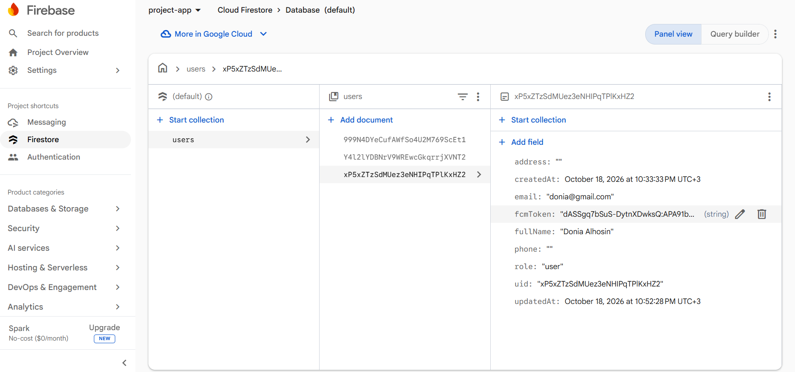<br/>
      <sub>Firestore <code>users/{uid}</code> with <code>fcmToken</code> (wide)</sub>
    </td>
  </tr>
  <tr>
    <td align="center" width="50%">
      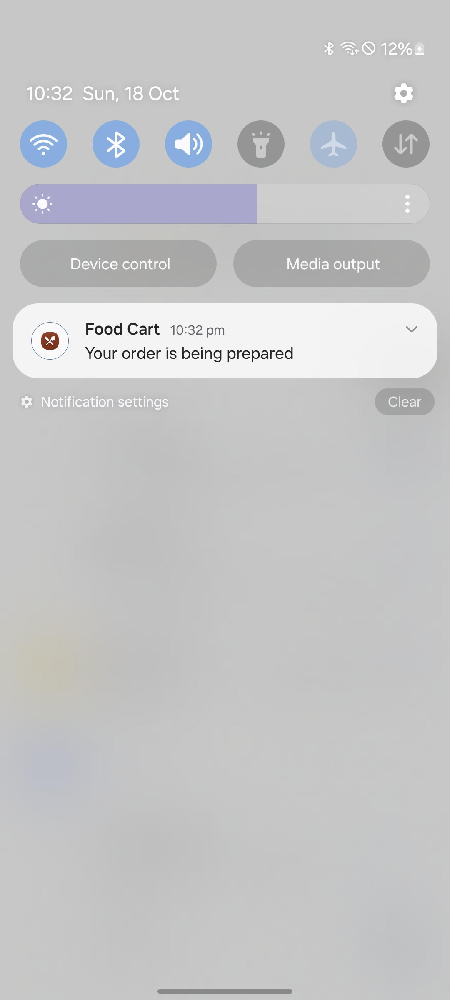<br/>
      <sub>FCM test · “Your order is being prepared”</sub>
    </td>
    <td align="center" width="50%">
      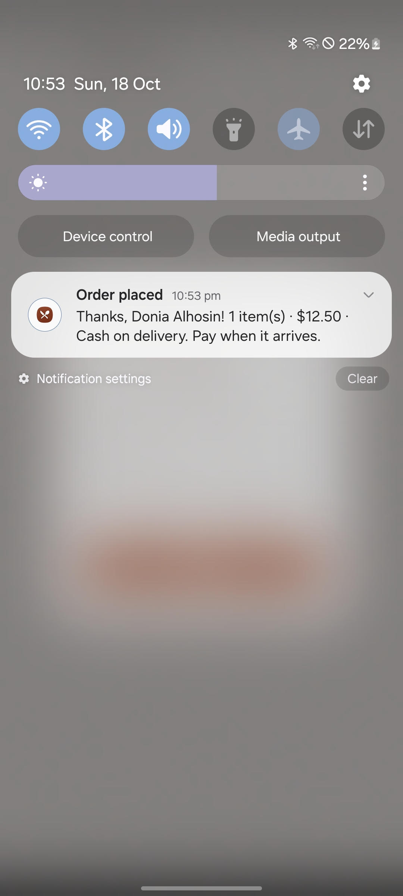<br/>
      <sub>Order placed · local notification after checkout</sub>
    </td>
  </tr>
</table>

### Firebase Console (wide) + Profile

Auth roles are **not** in Authentication — they live in Firestore `users.role`.

<table width="100%">
  <tr>
    <td align="center" width="66%" colspan="2">
      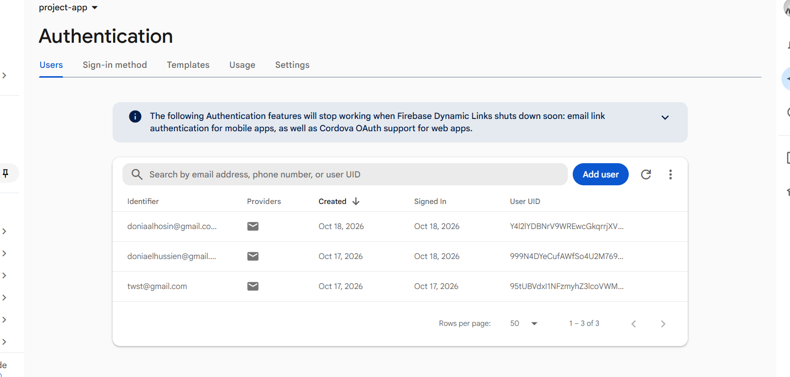<br/>
      <sub>Firebase Authentication · Users (wide)</sub>
    </td>
    <td align="center" width="34%">
      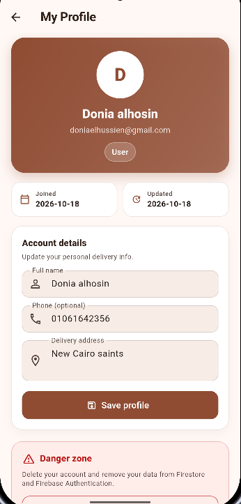<br/>
      <sub>My Profile</sub>
    </td>
  </tr>
  <tr>
    <td align="center" width="66%" colspan="2">
      <br/>
      <sub>Firestore <code>users</code> collection (wide)</sub>
    </td>
    <td align="center" width="34%">
      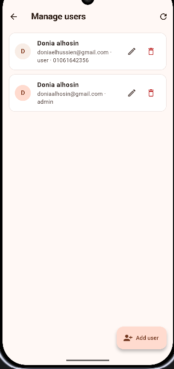<br/>
      <sub>Manage users</sub>
    </td>
  </tr>
</table>

### Admin management (phone)

<table width="100%">
  <tr>
    <td align="center" width="33%">
      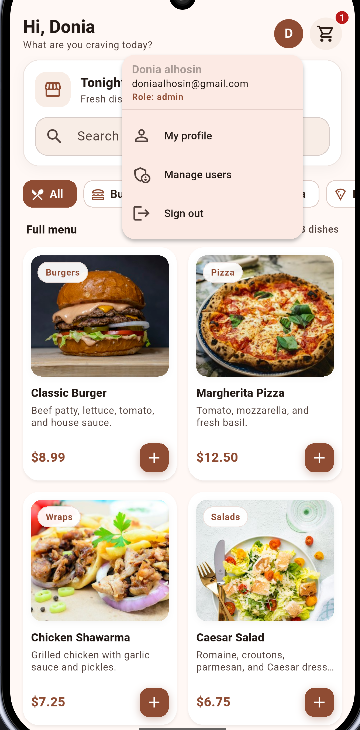<br/>
      <sub>Admin menu · Manage users</sub>
    </td>
    <td align="center" width="33%">
      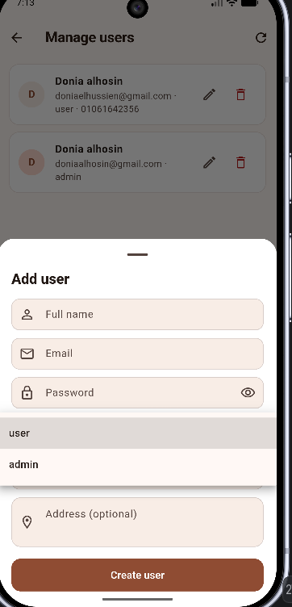<br/>
      <sub>Add user · role user/admin</sub>
    </td>
    <td align="center" width="33%">
      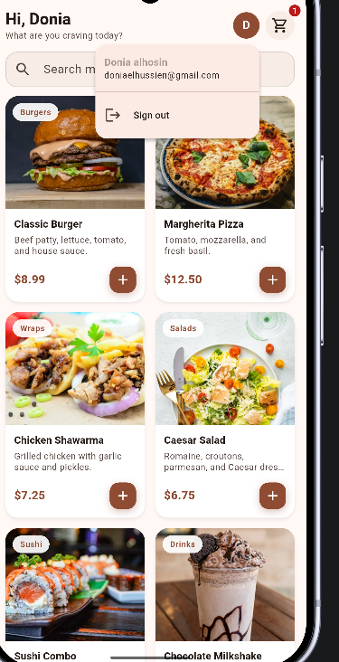<br/>
      <sub>Logged-in menu</sub>
    </td>
  </tr>
</table>

### Auth & ordering (phone)

<table width="100%">
  <tr>
    <td align="center" width="33%">
      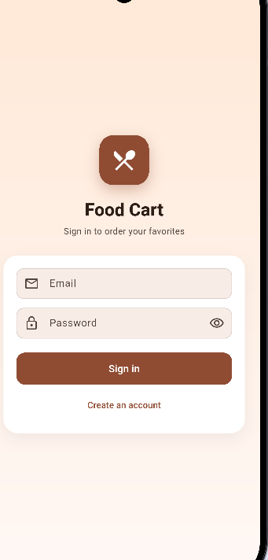<br/>
      <sub>Login</sub>
    </td>
    <td align="center" width="33%">
      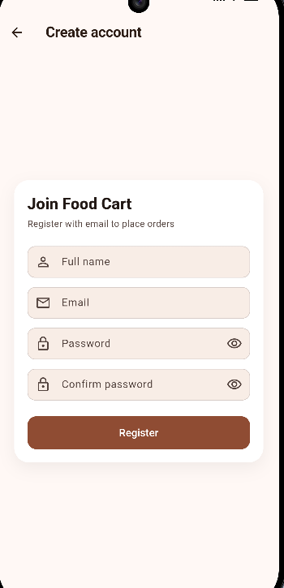<br/>
      <sub>Register</sub>
    </td>
    <td align="center" width="33%">
      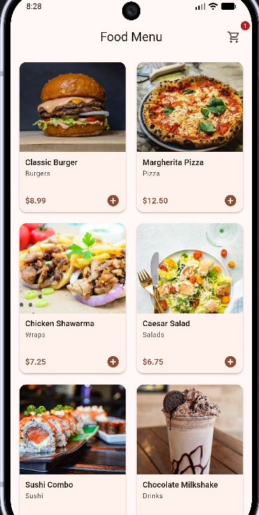<br/>
      <sub>Food menu</sub>
    </td>
  </tr>
  <tr>
    <td align="center" width="33%">
      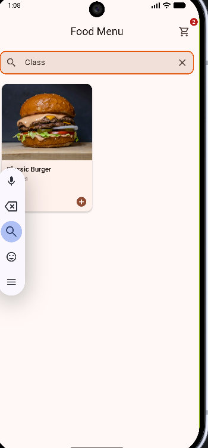<br/>
      <sub>Menu search</sub>
    </td>
    <td align="center" width="33%">
      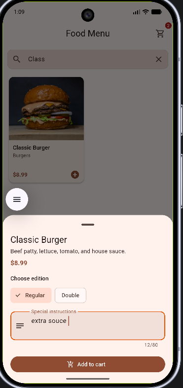<br/>
      <sub>Special instructions</sub>
    </td>
    <td align="center" width="33%">
      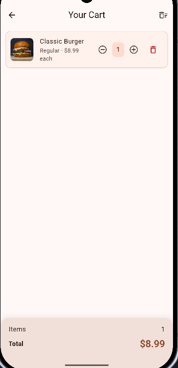<br/>
      <sub>Cart</sub>
    </td>
  </tr>
  <tr>
    <td align="center" width="33%">
      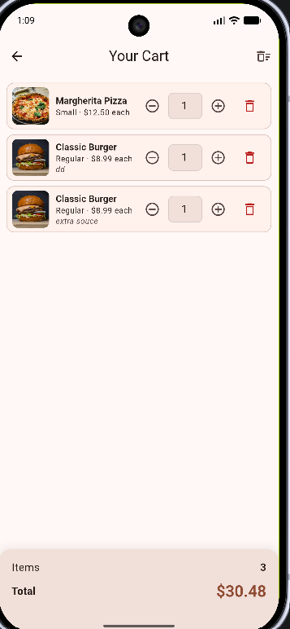<br/>
      <sub>Cart notes</sub>
    </td>
    <td align="center" width="33%"></td>
    <td align="center" width="33%"></td>
  </tr>
</table>

## License

Educational project for Week 10–12 (Sessions 20–24: S20 cart, S21 extensions, S22 Auth/checkout, S23 Firestore users, S24 FCM).
